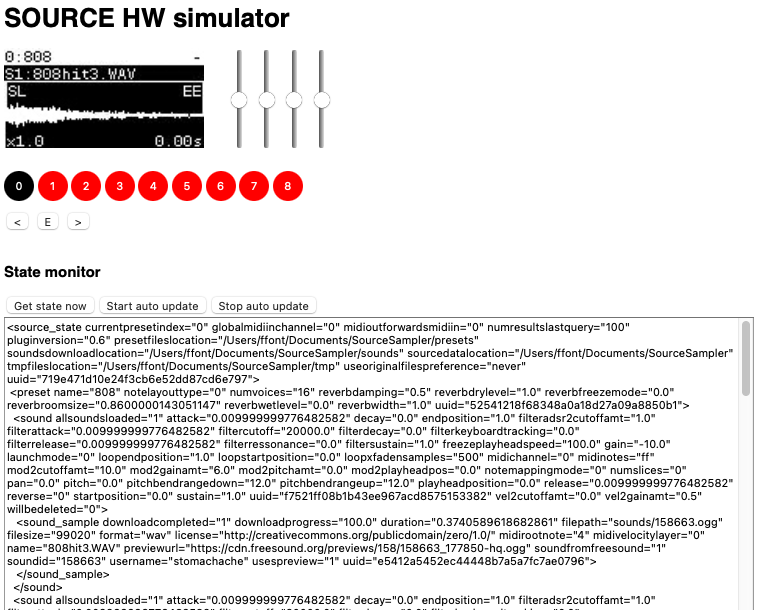
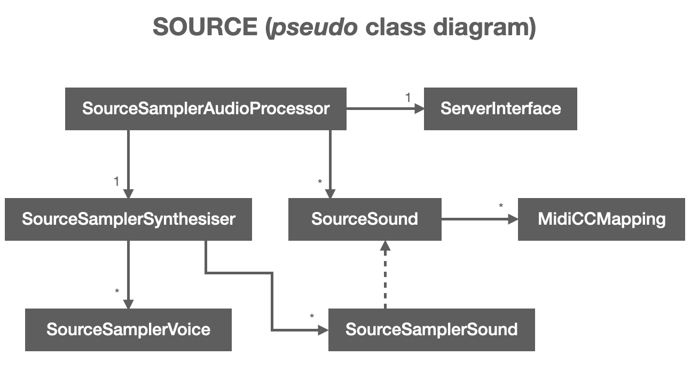

# Developers

* [Building SOURCE sampler engine](#building-source-sampler-engine)
    * [Build standalone/plugin for desktop (macOS)](#build-standaloneplugin-for-desktop-macos)
    * [Build standalone/plugin for desktop (linux)](#build-standaloneplugin-for-desktop-linux)
    * [Build plugin for Elk platform](#build-plugin-for-elk-platform)
    * [Prepare Elk development SDK](#prepare-elk-development-sdk)
    * [Prepare VST2 SDK](#prepare-vst2-sdk)
    * [Do the cross-compilation](#do-the-cross-compilation)
    * [Deploying SOURCE in the Elk board](#deploying-source-in-the-elk-board)
    * [Note about JUCE version used for SOURCE](#note-about-juce-version-used-for-source)
* [Using the BLACKBOARD simulator in development](#using-the-blackboard-simulator-in-development)
* [Architecture and *pseudo* class diagram](#architecture-and-pseudo-class-diagram)
* [Preset file strcuture](#preset-file-structure)
* [Controlling plugin from UI](#controlling-plugin-from-UI)
* [Working on the desktop plugin UI](#working-on-the-desktop-plugin-ui)
* [Adding or modifying sound parameters of the sampler engine](#adding-or-modifying-sound-parameters-of-the-sampler-engine)


## Building SOURCE sampler engine

The sampler engine of SOURCE is implemented as a JUCE audio plug-in and can be edited and built using standard JUCE workflows. The first step is to clone this repository and init the submodules. Then, different steps apply to build SOURCE for desktop computers or for the Elk platform (see below).

```
git clone https://github.com/ffont/source.git && cd source && git submodule update --init
```

### Build with CMake (recommended, macOS)

SOURCE is now built with CMake (JUCE 9, see `SourceSampler/CMakeLists.txt`). The `.jucer` project and the `Builds/` folder are kept only for the legacy Elk/iOS workflows described below.

1. Clone with submodules (`git submodule update --init --recursive`) and create `SourceSampler/Source/api_key.h` from `api_key.example.h` with your Freesound API key (or pass `-DSOURCE_FREESOUND_API_KEY=...` to CMake).
2. Build the release plugins (AU, VST3, Standalone), run the tests and install them:

```
cd SourceSampler
./build_and_install.sh            # --no-install, --no-tests, --clean are also available
```

Or build manually:

```
cmake -S SourceSampler -B SourceSampler/build -G Ninja -DCMAKE_BUILD_TYPE=Debug
cmake --build SourceSampler/build --target SourceSampler_Standalone
cd SourceSampler/build && ctest --output-on-failure
```

CMake options: `SOURCE_WEB_UI` (use the legacy browser-based editor instead of the native JUCE editor, default OFF), `SOURCE_INCLUDE_SEQUENCER` (SourceShepherd variant, untested with CMake), `SOURCE_BUILD_TESTS` (default ON), `SOURCE_BUILD_AUV3` (default OFF).

Threading notes for developers: the sampler state (`SourceSampler::state` ValueTree) must only be modified from the message thread. Background threads (sound loading, downloads, Freesound queries, time stretching) post their results to the message thread, and MIDI CC mappings/program changes received in the audio thread are queued and applied in the message thread. Tests can be run under ThreadSanitizer by configuring with `-DCMAKE_CXX_FLAGS=-fsanitize=thread -DCMAKE_C_FLAGS=-fsanitize=thread -DCMAKE_EXE_LINKER_FLAGS=-fsanitize=thread`.

In debug builds, setting `SOURCE_DEBUG_ADD_FILE=<audio file>` loads a local file as a sound when the editor opens, and `SOURCE_DEBUG_SNAPSHOT=<png>` renders the editor to a PNG (handy for checking UI changes without screen access).

### Build for Linux

The CMake project builds the standalone app (ALSA and JACK), VST3 and LV2 plugins on Linux. The packages needed are listed in `SourceSampler/linux/dependencies.txt` (Ubuntu names). `linux/build_linux.sh` builds them (Release), runs the tests and packages each format in a zip file in `dist/`. On a Mac, `linux/build_in_docker.sh` does the same in an Ubuntu 22.04 container (Docker or OrbStack; `PLATFORM=linux/amd64` builds for x86_64).

```
cd SourceSampler
sudo apt-get install $(cat linux/dependencies.txt)
CC=gcc-12 CXX=g++-12 ./linux/build_linux.sh
```

### Build for Windows

The CMake project builds the standalone app and the VST3 plugin on Windows (x64) with Visual Studio 2022 (C++ workload). `windows/build_windows.sh` (run it in Git Bash) builds them (Release), runs the tests and packages each format in a zip file in `dist/`:

```
cd SourceSampler
./windows/build_windows.sh
```

### Make a release

`make_release.sh` builds universal (Apple Silicon and Intel) Release versions of the macOS standalone app, Audio Unit and VST3 plugin (running the tests), packages each in a zip file and creates a GitHub release (tag `v<version>`, by default the version in `CMakeLists.txt`) with them, using the GitHub CLI (`gh`). Publishing the release starts the "Linux and Windows release builds" GitHub Actions workflow (`.github/workflows/linux-release.yml`), which builds the Linux standalone app, VST3 and LV2 plugins for x86_64 and arm64 and the Windows standalone app and VST3 plugin for x64, and attaches them to the release; the script waits for it. The working tree must be clean and the current commit pushed. Builds are ad-hoc signed, not notarized.

The Linux and Windows builds get the Freesound API key from the `FREESOUND_API_KEY` repository secret (set it once with `gh secret set FREESOUND_API_KEY`).

```
cd SourceSampler
./make_release.sh --dry-run                # build and package the macOS version only (files in dist/)
./make_release.sh                          # release the version in CMakeLists.txt
./make_release.sh 1.0.1 --notes-file notes.md --prerelease
```

The workflow can also be run manually (Actions tab, or `gh workflow run linux-release.yml --ref <branch> -f tag=<tag> -f platforms=windows`): it builds the selected branch and, if a tag is given, attaches the builds to that release (e.g. to add a platform to an existing release).

### Build for iPad (iOS/iPadOS)

The CMake project also builds an iPad version: a standalone app with an embedded AUv3 plugin (usable in iPad hosts such as AUM, Cubasis, Logic Pro for iPad...). The native UI adapts to the iPad screen in both orientations (it is scaled down on smaller screens, and cards are stacked in portrait).

```
cd SourceSampler
./build_ios.sh                                  # generate build-ios/SourceSampler.xcodeproj, then run from Xcode
./build_ios.sh --simulator --install            # build and install in the booted iOS simulator
TEAM_ID=<your team id> ./build_ios.sh --device --install  # signed build, installed on the connected iPad
```

Notes:
- To run on a real iPad you need an Apple development team (`TEAM_ID`, or set the team in Xcode's "Signing & Capabilities"). The team ID is the `OU` field of your "Apple Development" certificate. With `--device`, Xcode's automatic signing registers the bundle IDs (`com.ffont.SourceSampler` and `com.ffont.SourceSampler.SourceSamplerAUv3`) and the app group in your team.
- The app and the AUv3 share sounds and presets through the app group `group.ffont.source` (CMake option `SOURCE_IOS_APP_GROUP`, or `APP_GROUP` in the script). The group must be registered in your team; set it to an empty value to disable it (each target then uses its own Documents folder).
- The app group folder is not visible in the Files app. To add presets (e.g. from a SOURCE hardware unit, where they are in `/udata/source/presets`), copy the preset files (`<preset number>.xml`) to "On My iPad › SourceSampler › SourceSampler › presets" in the Files app: the standalone app moves them to the shared presets folder (replacing presets with the same number) at launch and every couple of seconds while running. Without the app group, that folder is the presets folder itself.
- iOS can kill suspended apps without giving them a chance to save, so the standalone app autosaves its session (`last_session.xml` in the data folder) a couple of seconds after every change and restores it on launch. The AUv3's state is saved by the host.
- MIDI controllers (USB, network and Bluetooth MIDI) are opened automatically by the standalone app. Dropping audio files is a desktop-only feature.
- The standalone app supports [Ableton Link](https://www.ableton.com/link/) and Link Audio (CMake option `SOURCE_IOS_LINK`, on by default; it uses the open-source Link library, a git submodule in `3rdParty/link`, so run `git submodule update --init --recursive`). In the "Settings" tab, turn on "Link" to join the Link session on the local network and "Link Audio" to publish SOURCE's output as an audio channel named "SOURCE", which other Link Audio peers (e.g. Ableton Live) can receive. SOURCE doesn't follow the Link tempo yet. The settings are stored in `link_settings.xml` in the data folder.
- Link finds other devices with UDP multicast, which iOS only allows to apps with the `com.apple.developer.networking.multicast` entitlement. Apple has to approve it for your team (request it at https://developer.apple.com/contact/request/networking-multicast); then build with `MULTICAST=1 TEAM_ID=<your team id> ./build_ios.sh --device --install` (CMake option `SOURCE_IOS_MULTICAST_ENTITLEMENT`). Without it, the app builds and runs but won't find other Link devices on a real iPad (the simulator works without it). The first time Link is turned on, iOS asks for permission to use the local network.
- Link is licensed under GPLv2 or later (also available under a proprietary license from Ableton, as LinkKit for iOS). Builds with Link should be distributed under the GPL; build with `-DSOURCE_IOS_LINK=OFF` to leave it out.

### Build standalone/plugin for desktop (macOS, legacy Projucer workflow)

1. Clone the source code repository in your local computer

```
git clone https://github.com/ffont/source.git && cd source && git submodule update --init
```

2. Install openssl dependency (needs `brew` or something similar):

```
brew install openssl
```

3. Before compiling, note SOURCE requires a Freesound API key to connect to Freesound. You should make an account in Freesound (if you don't have one) and go to [this URL to generate an APi key](https://freesound.org/apiv2/apply). Then you should edit the file `/source/SourceSampler/Source/api_key.example.h`, add your key, and then then save and rename the file to `/source/SourceSampler/Source/api_key.h`.

4. Make sure the VST2 SDK files are placed in a folder named `VST_SDK` which lies at the same hierarchy level where the main `source` folder is. You can also opt to disable building the VST2 target (see NOTE 2 below). I can't share these SDK files, but you might find them somewhere.

5. Then you can compile SOURCE using the XCode project files in `/source/SourceSampler/Builds/MacOSX/` (see note below about compiling `BinaryBuilder` as this will be required if compiling from XCode project files). Alternatively, you can use the Python3 deploy script bundled in this repo to run the compilation step (note that you need to install dependencies for the deploy script by running `pip install -r requirements_fabfile.txt`):

```
fab compile
```

This will create *Release* versions of SOURCE (VST3, VST2, AU and Standalone) ready to work on the mac. If you need *Debug* build, you can run `fab compile-debug`. If you want to compile the version of SOURCE which includes the sequencer, then you should run `fab compile-with-sequencer` (or `fab compile-debug-with-sequencer`). Note that the created binaries are names `SourceShepherd.app`, whereas when compiling without the sequencer the binaries are simply called `Source.app`. You'll find binaries somwhere in the `source/SourceSampler/Builds/MacOSX/build/` folde


**NOTE**: For development you might need to edit the `SourceSampler.jucer` Projucer file. To do that, you need a compatible version of Projucer installed. You can compile it (for macOS) from JUCE source files using a the deploy script running: `fab compile-projucer`. The generated executable will be in `/source/SourceSampler/3rdParty/JUCE/extras/Projucer/Builds/MacOSX/build/Release/Projucer.app`.

**NOTE 2**: SOURCE is configured to build a VST2 version of the plugin (together with VST3, AudioUnit and StandAlone). VST2 is currently only needed for the Elk build as there still seem to be some issues with JUCE6 + VST3 in linux. However, VST is not really needed for the macOS compilation. If you don't have the VST2 SDK available, just open `SourceSampler.jucer` (you'll need to compile Projucer first as described in the previous step) and untick `VST Legacy` option.

**NOTE 3**: macOS build targets include a *pre-build shell script* phase which generates the `BinaryData.h/.cpp` files needed for the plugin to show the UI. These files are generated with the `BinaryBuilder` util provided in the JUCE codebase. `BinaryBuilder` is compiled as part of the build process so you should encounter no issues with that.


### Build standalone/plugin for desktop (linux)


1. Clone the source code repository in your local computer

```
git clone https://github.com/ffont/source.git && cd source && git submodule update --init
```

2. Install system dependencies:

```
sudo apt update
sudo apt install libasound2-dev libjack-jackd2-dev \
    libcurl4-openssl-dev libssl-dev \
    libfreetype6-dev \
    libx11-dev libxcomposite-dev libxcursor-dev libxcursor-dev libxext-dev libxinerama-dev libxrandr-dev libxrender-dev \
    libwebkit2gtk-4.0-dev \
    libglu1-mesa-dev mesa-common-dev
sudo apt-get install xvfb
```

3. Before compiling, note SOURCE requires a Freesound API key to connect to Freesound. You should make an account in Freesound (if you don't have one) and go to [this URL to generate an APi key](https://freesound.org/apiv2/apply). Then you should edit the file `/source/SourceSampler/Source/api_key.example.h`, add your key, and then then save and rename the file to `/source/SourceSampler/Source/api_key.h`.

4. Make sure the VST2 SDK files are placed in a folder named `VST_SDK` which lies at the same hierarchy level where the main `source` folder is. You can also opt to disable building the VST2 target (see NOTE 2 below). I can't share these SDK files, but you might find them somewhere.

5. Use the Python3 deploy script bundled in this repo to run the compilation step (note that you need to install dependencies for the deploy script by running `pip install -r requirements_fabfile.txt`):

```
fab compile
```

This will create *Release* versions of SOURCE (VST3, VST2, and Standalone) ready to work on linux. If you need *Debug* build, you can run `fab compile-debug`. If you want to compile the version of SOURCE which includes the sequencer, then you should run `fab compile-with-sequencer` (or `fab compile-debug-with-sequencer`).  Note that the created binaries are names `SourceShepherd`, whereas when compiling without the sequencer the binaries are simply called `Source`. You'll find binaries somwhere in the `source/SourceSampler/Builds/LinuxMakefile/build/` folder.


**NOTE**: For development you might need to edit the `SourceSampler.jucer` Projucer file. To do that, you need a compatible version of Projucer installed. You can compile it (for macOS) from JUCE source files using a the deploy script running: `fab compile-projucer`. The generated executable will be in `/source/SourceSampler/3rdParty/JUCE/extras/Projucer/Builds/LinuxMakefile/build/Projucer.app`.

**NOTE 2**: SOURCE is configured to build a VST2 version of the plugin (together with VST3, AudioUnit and StandAlone). VST2 is currently only needed for the Elk build as there still seem to be some issues with JUCE6 + VST3 in linux. However, VST is not really needed for the macOS compilation. If you don't have the VST2 SDK available, just open `SourceSampler.jucer` (you'll need to compile Projucer first as described in the previous step) and untick `VST Legacy` option.

**NOTE 3**: a JUCE utility tool is needed to generate the `BinaryData.h/.cpp` files needed for the plugin to show the UI. These files are generated with the `BinaryBuilder` util provided in the JUCE codebase. `BinaryBuilder` is compiled as part of the build script so you should encounter no issues with that.


### Build plugin for Elk platform

To build SOURCE for Elk Audio OS you need to cross-compile it from your development computer. To do that, I use a Docker-based solution on macOS. The instructions here are therefore for cross-compiling from macOS and using Docker. For cross-compilation from Linux it should be simpler and you should refer to the Elk docs. The python deploy script bundled in this repository will automate most of the steps for compiling SOURCE for the Elk platform. To run that script you'll need to install the required Python3 dependencies by running `pip install -r requirements_fabfile.txt`. The sections below guide you through the process of preparing your dev environment for compiling SOURCE for the Elk platform and show how to do th actual compilation.


#### Prepare Elk development SDK

The first thing to do is to prepare the Elk development SDK Docker image following the [instrucitons here](https://github.com/elk-audio/elkpi-sdk/blob/master/running_docker_container_on_macos.md). You need to run steps 1 to 3, no need to run the toolchain when everything installed.


#### Prepare VST2 SDK

Even though JUCE 6 has support for VST3 plugins in Linux, I've had some issues with VST3 versions of plugins in Linux and therefore SOURCE is still being built as VST2. This means that you need the VST2 SDK installed in your computer to compile SOURCE. Make sure that the `PATH_TO_VST2_SDK` variable in `fabfile.py` points to a valid distribution of the VST2 SDK. This will be mounted in the Docker container that does the cross-compilation. Of course you also need to get the VST2 SDK files from somewhere.

#### Do the cross-compilation

With all this in place, you should be able to cross-compile SOURCE for Elk in a very similar way as you would do it for the desktop version, using the deploy script:

```
fab compile-elk
```

(if you need a *Debug* build, you can use `fab compile-elk-debug`)

This will take a while, specially the first time it runs. When it finishes, it should have generated a `SourceSampler.so` file in `source/Builds/ElkAudioOS/build/` which is the VST2 plugin that you can run in the Elk platform. It also generates a VST3 in `source/Builds/ElkAudioOS/build/SourceSampler.vst3` which should also compatible with the Elk platform but there still seem to be issues with the VST3 version so it is not really used.

**NOTE**: The build script for the cross compilation includes a step which generates the `BinaryData.h/.cpp` files needed for the plugin to include up-to-date resources (mainly `index.html`). This is run in the host machine and not in the Docker container. For this step to succeed, you need to compile the  `BinaryBuilder` util provided by JUCE. You can compile that by running `fab compile-binary-builder-macos`.


#### Deploying SOURCE in the Elk board

Once the plugin is compiled for the Elk architecture, you can install it in the Elk board by following the steps for [Running SOURCE in the Elk hardware stack](#running-source-in-the-elk-hardware-stack).


### Note about JUCE version used for SOURCE

The current version of SOURCE uses JUCE 6 which has native support for VST3 plugins in Linux and for headless plugins. Therefore, unlike previous version of SOURCE, we don't need any patched version of JUCE and we can simply use the official release :) However, there still seem to be problems with VST3 and Linux related with timers, so we use VST2 builds.

 
## Using the BLACKBOARD simulator in development

In order to facilitate development of the *hardware* version of SOURCE when the Elk tech stack is not available, the *glue app* implemented in Python3 can also be run from your local computer and includes a web simulator of the BLACKBOARD hardware that can be used as user interface. The glue app will communicate with the plugin, which must be running also in your local computer as a standalone app and must have been compiled in Debug mode, and you can point your browser at `http://localhost:8123/simulator` to see the BLACKBOARD simulator that looks like this:

<p align="center">

</p>

These are the steps to get the simulator up and running:

1. Compile the desktop version of the plugin in Debug mode and run it as a Standalone app (or as a plugin inside a DAW)
2. Install python dependencies for the glue app, and run the glue app

```
cd elk_platform/ui_app
pip install -r requirements.txt
pyhon main
```
3. Point your browser to `http://localhost:8123/simulator` and use the buttons on screen to interact with the plugin as if interactions came from the hardware BLACKBOARD.


## Architecture and *pseudo* class diagram

Please check the main [README][README.md] for an overall description of how SOURCE works, including the two block diagrams 
of SOURCE running in the ELK hardware stack or as an audio plugin/stand-alone application in a desktop computer. As it can 
be seen in the diagrams, the UI of SOURCE is completely separated from the sampler audio engine. In the case of ELK deployments,
the UI is implemented as a Python script (see `elk_platform/ui_app/` folder), and when running on desktop computers the UI
is implemented with HTML/Javascript (see `SourceSampler/Resources/ui_plugin_ws.html`). The way in which the UI communicates
with the sampler engine to obtain the state of the app and trigger actions in the engine is [described below](#controlling-plugin-from-UI).

The most important thing to understand of the sampler engine is the *pseudo* class diagram which shows the most important classes and 
gives an idea of the structure of the app. This should be helpful for anyone willing to contribute to SOURCE. See the *pseudo* class diagram
below and a brief explanation of the relevance of each of the classes in the diagram:

<p align="center">

</p>


* **`SourceSamplerAudioProcessor`**: this is the main class of the application is the owner of an instance of the `ServerInterface`, an instance of the `SourceSamplerSynthesiser`, and as many instances of `SourceSound` as sounds are loaded in the plugin. This class also holds the main state of the application in a `state` member using JUCE's `juce::ValueTree` structure. The whole hierarchy of objects in SOURCE is governed and created after the contents of that `state` variable. See [this great talk by Dave Rowland](https://www.youtube.com/watch?v=3IaMjH5lBEY) in which he discusses this technique. When SOURCE runs in desktop computers, the `SourceSamplerAudioProcessor` also has the methods for communicating with Freesound.

* **`ServerInterface`**: this class is the one that handles all the communications with the UI(s). It includes a **WebSockets server** that can be used by UI(s) to send messages to the sampler engine and to receive information about plugin's state. The `ServerInterface` class also implements an Open Sound Control server that can be used by exactly the same purposes as the WebSockets one. Before implementing the WebSockets server, the OSC server was used for remote contorl. Currently it is not used but the code is still here in case it becomes useful. Finally, the `ServerInterface` also has an **HTTP server** which is **only used when SOURCE runs on desktop computers** and it can serve sound the full files to the UI in case these are needed (e.g. to draw a waveform).

* **`SourceSound`**: there will be multiple instances for this class, one for every sound loaded in the sampler. Each instance of `SourceSound` holds the values of all the available sound parameters nad has methods to set and retrieve them. This class **does not hold any audio data** as this is delegated to the `SourceSamplerSound` class (see below). Typically, one instance of `SourceSound` will create an instance of `SourceSamplerSound` (note however that `SourceSamplerSound` is not owned by `SourceSound` but owned by `SourceSamplerSynthesiser`), because when one sound is loaded, an instance of `SourceSamplerSound` is created with the audio contents and extra metadata of that sound. However, SOURCE supports multi-samples, meaning that one single `SourceSound` can create several instances of `SourceSamplerSound` is different audio files are to played depending on the MIDI notes pressed or velocity layers. `SourceSound` therefore includes methods to create `SourceSamplerSound` instances, to download the corresponding sounds and load them into memory, and to add the created `SourceSamplerSound` instances to the sampler (to the `SourceSamplerSynthesiser` instance). `SourceSound` also has methods to handle deletion of these objects.  Finally, `SourceSound` instances own a list of `MidiCCMapping` instances and also include methods to manage them.

* **`SourceSamplerSound`**: an instance of `SourceSamplerSound` is created for each of the audio files currently loaded into the sampler's memory. `SourceSamplerSound` instances keep a reference to the `SourceSound` that created them. This reference is used, among other things, for retrieving the sound parameter values that should be used when playing that sound file (e.g. gain and filter cutoff). `SourceSamplerSound` instances' lifetime is managed by the referenced `SourceSound` objects, but they are indeed owned by the `SourceSamplerSynthesiser` instance.

* **`MidiCCMapping`**: these objects are used to store the relation of MIDI CC numbers, which sound parameters these should affect and with what range. `MidiCCMapping` instances are owned by `SourceSound`.

* **`SourceSamplerSynthesiser`**: this class manages the MIDI input, chooses which sounds should be played depedning on the incoming MIDI notes, and deals with the rendering of the actual audio buffers through `SourceSamplerVoice` instances. Also, `SourceSamplerSynthesiser` owns a list of `SourceSamplerSound` objects which contain the loaded sounds that can be played in response to MIDI notes. When a MIDI note arrives, `SourceSamplerSynthesiser` will find an empty `SourceSamplerVoice` instance and tell it to play the `SourceSamplerSound` corresponding with the input MIDI note.

* **`SourceSamplerVoice`**: this class is the one that does the actual audio rendering of a specific `SourceSamplerSound` when it is being played. It holds a reference to the `SourceSamplerSound` being played, and throught it has access to the values of sound parameters (because `SourceSamplerSound` points to the `SourceSound` that created it). With all that information, the `SourceSamplerVoice` instance calculates the audio samples that need to be placed in the audio buffer every time that the `renderNextBlock` is called. This is the class that does virtually all of the audio processing in SOURCE.


You can look at the implementation of these classes in the sources files under `SourceSampler/Source`. Most of them are declared/implemented in source code files of the same names. A notable exception is `SourceSound`, whose declatration/implementation shares file with `SourceSamplerSound`.


## Preset file strcuture

SOURCE presets are stored as `.xml` documents that will be placed in the `~/Documents/SourceSampler/presets` folder.
Files are named with the **number of the preset as the filename** (e.g. `10.xml`). If SOURCE is trying to load a preset
and no file exists with that preset number, it will create a new empty preset.

The preset file structure follows a similar structure to that of the class diagram, with the root `PRESET` element containing
an indefinite number of `SOUND` elements which can also contain any number of `SOUND_SAMPLE` and `MIDI_CC_MAPPING` elements.
`SOUND_SAMPLE` elements can also contain an `ANALYSIS` element with the output of the analysis of that sound. Below is an example
preset file with 2 sounds. The first sound also has 2 configured MIDI CC mappings, and the second one has analysis data.
Note that looking at this example file is also good to see what preset parameters and sound parameters are available (see 
the properties of `PRESET` and `SOUND` elements, respectively). See some devleopment notes about [modifying and updating
the available sound parameters](#adding-or-modifying-sound-parameters-of-the-sampler-engine) below.


```xml
<?xml version="1.0" encoding="UTF-8"?>

<PRESET uuid="6ed7834fe18a4627b4c3b27b69693d38" name="2 sounds of nature"
        noteLayoutType="0" numVoices="8" reverbDamping="0.0" reverbWetLevel="0.5"
        reverbDryLevel="1.0" reverbWidth="1.0" reverbFreezeMode="1.0"
        reverbRoomSize="0.3">
  <SOUND uuid="084552fc5abe4640881a9765d7274dc1" midiChannel="0" midiNotes="ffffffff"
         launchMode="0" startPosition="0.0" endPosition="1.0" loopStartPosition="0.0"
         loopEndPosition="1.0" loopXFadeNSamples="500" reverse="0" noteMappingMode="0"
         numSlices="0" playheadPosition="0.0" freezePlayheadSpeed="100.0"
         filterCutoff="20000.0" filterRessonance="0.0" filterKeyboardTracking="0.0"
         filterAttack="0.009999999776482582" filterDecay="0.0" filterSustain="1.0"
         filterRelease="0.009999999776482582" filterADSR2CutoffAmt="1.0"
         gain="-10.0" attack="0.009999999776482582" decay="0.0" sustain="1.0"
         release="0.009999999776482582" pan="0.0" pitch="0.0" pitchBendRangeUp="12.0"
         pitchBendRangeDown="12.0" mod2CutoffAmt="10.0" mod2GainAmt="6.0"
         mod2PitchAmt="0.0" mod2PlayheadPos="0.0" vel2CutoffAmt="0.0"
         vel2GainAmt="0.5">
    <SOUND_SAMPLE uuid="eadebe15eda14c81abcf19523e63f939" name="P&#225;ssaro.m4a" soundId="517784"
                  username="Nicoleamado1" license="http://creativecommons.org/licenses/by/3.0/" filesize="122644"
                  format="m4a" previewURL="https://cdn.freesound.org/previews/517/517784_11129824-hq.ogg"
                  soundFromFreesound="1" usesPreview="1" midiRootNote="16" midiVelocityLayer="0"
                  sampleStartPosition="-1.0" sampleEndPosition="-1.0" sampleLoopStartPosition="-1.0"
                  sampleLoopEndPosition="-1.0"/>
    <MIDI_CC_MAPPING uuid="bb48171ba48b4a13b892f89e55818d9e" ccNumber="10" parameterName="filterCutoff"
                     minRange="0.2899999916553497" maxRange="0.7799999713897705"/>
    <MIDI_CC_MAPPING uuid="7e65f5d7774b4aa985dfd29e32fa69d1" ccNumber="11" parameterName="pan"
                     minRange="0.0" maxRange="1.0"/>
  </SOUND>
  <SOUND uuid="d5ced7dfbc9e4a0c91a30b1791914780" midiChannel="0" midiNotes="ffffffff00000000"
         launchMode="0" startPosition="0.0" endPosition="1.0" loopStartPosition="0.0"
         loopEndPosition="1.0" loopXFadeNSamples="500" reverse="0" noteMappingMode="0"
         numSlices="0" playheadPosition="0.0" freezePlayheadSpeed="100.0"
         filterCutoff="20000.0" filterRessonance="0.0" filterKeyboardTracking="0.0"
         filterAttack="0.009999999776482582" filterDecay="0.0" filterSustain="1.0"
         filterRelease="0.009999999776482582" filterADSR2CutoffAmt="1.0"
         gain="-10.0" attack="0.009999999776482582" decay="0.0" sustain="1.0"
         release="0.009999999776482582" pan="0.0" pitch="0.0" pitchBendRangeUp="12.0"
         pitchBendRangeDown="12.0" mod2CutoffAmt="10.0" mod2GainAmt="6.0"
         mod2PitchAmt="0.0" mod2PlayheadPos="0.0" vel2CutoffAmt="0.0"
         vel2GainAmt="0.5">
    <SOUND_SAMPLE uuid="35589f5200f447adbd03113f4f54bcd7" name="Field Recording.m4a" soundId="567075"
                  username="regas23" license="http://creativecommons.org/licenses/by/3.0/" filesize="160283"
                  format="m4a" previewURL="https://cdn.freesound.org/previews/567/567075_12718295-hq.ogg"
                  soundFromFreesound="1" usesPreview="1" midiRootNote="48" midiVelocityLayer="0"
                  sampleStartPosition="-1.0" sampleEndPosition="-1.0" sampleLoopStartPosition="-1.0"
                  sampleLoopEndPosition="-1.0">
      <ANALYSIS>
        <onsets>
          <onset onsetTime="0.03482993319630623"/>
          <onset onsetTime="1.207437634468079"/>
          <onset onsetTime="2.03174614906311"/>
          <onset onsetTime="2.275555610656738"/>
          <onset onsetTime="2.600634813308716"/>
          <onset onsetTime="2.844444513320923"/>
          <onset onsetTime="3.657142877578735"/>
          <onset onsetTime="3.889342308044434"/>
          <onset onsetTime="3.970612287521362"/>
          <onset onsetTime="4.063492298126221"/>
          <onset onsetTime="4.14476203918457"/>
          <onset onsetTime="5.305759429931641"/>
          <onset onsetTime="5.688889026641846"/>
        </onsets>
      </ANALYSIS>
    </SOUND_SAMPLE>
  </SOUND>
</PRESET>
```

Slices: when a sound's note mapping mode uses slices (`noteMappingMode` 1 or 2), `numSlices` 2-100 splits the sound
between its start and end positions in that number of equal slices, and `numSlices` 0 ("Man" in the native UI) uses the
sound's manual slices: the `slices` property of `SOUND` (comma-separated times in seconds of the original audio, at
most 100). n markers inside the start/end selection make n + 1 slices, and notes play the slice of their index (cycling).
The `onsets` in the `ANALYSIS` of the first `SOUND_SAMPLE` are the onset times from Freesound (`onset_times` field of the
API, saved when sounds are added), which can be turned into the manual slices ("Slices from waveform" in the native UI,
`/set_slices_from_onsets`). Presets from before 1.1 have no `slices` property: sounds with `numSlices` 0 (which then
meant "slices from the onsets") get their onsets as manual slices, and `numSlices` 1 (one slice per mapped note) becomes
that number of equal slices.

Note that if loading this preset file in SOURCE and then re-saving it, some extra properties might be saved. These correspond
to *volatile* properties which are only used while the plugin is running, and will be ignored if the preset is loaded again. 

TODO: link to other examples of preset files.

For an example program to generate presets for SOURCE, check the [Freesound Presets](https://github.com/ffont/freesound-presets)
project.


## Controlling plugin from UI

The SOURCE sampler engine exposes a remote control interface that can be accessed using WebSockets or, alternatively, Open Sound Control. This interface is also used to send infromation about the sampler engine state to the UI. Note that the sampler engine state looks exactly like the preset files shown above. Below is a list of the different plugin actions that can be triggered using the remote control interface. The actual details about how to connect to that interface and format the messages can be easily derived by looking at the source code of the UI(s) and also by looking at the implementation of the `actionListenerCallback` from `SourceSamplerAudioProcessor`.

### Global actions

| Action name | Action arguments | Description |
| --------------- | --------------- | --------------- |
| `/get_state` | [`state type` (String)] | Responds with a message including information about current state of the plugin. `state type` should be one of `full`/`volatile`/`volatileString`.  `full` will return the complete state in a serialized XML data structure (similar to the preset file). `volatile` will return information about the *volatile* aspects of the state (i.e. audio meters, playhead positions of sounds currently being played, ...) in a serialized XML data structure. `volatileString` will also return information about the volatile aspects of the state but in a comma-separated format and serialized to a string (see source code for more details).|
| `/play_sound_from_path` | [`path` (String)] | Plays a sound file that can be located locally in the path provided by the `path` argument. `path` can also be the URL of a sound and it will be downloaded and played accordingly (e.g. `https://freesound.org/data/previews/616/616799_3914271-hq.mp3`). This is mostly used for previewing Freesound search results and/or local sounds. |
| `/set_use_original_files` | [`preference` (String)] | Sets the preference for using original quality files from Freesound. `preference` should either `never` (never use original quality files, only use OGG previews), `always` (always use the original quality files), or `onlyShort` (only use original quality files for sounds weighting less than 15MB). |
| `/set_midi_in_channel` | [`channel` (Integer)] | Sets the default global MIDI in channel. All sounds configured to use the global MIDI in channel will use the one specified here. `0` means "All channels", while `1-16` means MIDI channels 1 to 16. |
| `/note_on` | [`note` (Integer), `velocity` (Integer), `channel` (Integer)] | Feeds a MIDI note ON message to the plugin with the specified MIDI `note` (0-127), `velocity` (0-127) and `channel` (0-16, where 0 means "global SOURCE MIDI channel" and 1-16 mean individual MIDI channels 1 to 16). |
| `/note_off` | [`note` (Integer), `velocity` (Integer), `channel` (Integer)] | Feeds a MIDI note OFF message to the plugin with the specified MIDI `note` (0-127), `velocity` (0-127) and `channel` (0-16, where 0 means "global SOURCE MIDI channel" and 1-16 mean individual MIDI channels 1 to 16). |


### Preset actions

| Action name | Action arguments | Description |
| --------------- | --------------- | --------------- |
| `/load_preset` | [`preset number` (Integer)] | Number of preset to load (can be any integer number, bigger than 128).|
| `/save_preset` | [`preset name` (String), `preset number` (Integer)] | Renames the preset to `preset name` and saves it to the `preset number` position.|
| `/set_reverb_parameters` | [`room size` (Float), `damping` (Float), `wet level` (Float), `dry level` (Float), `width` (Float), `freeze mode` (Float)] | Sets global reverb parameters to those indicated by the message. All parameters are in range 0-1.|
| `/set_fx_parameter` | [`parameter id` (String), `value` (Float)] | Sets a parameter of the effects applied after the sampler (drive, chorus, phaser, delay and compressor; reverb uses `/set_reverb_parameters`). The ids, ranges and defaults are in the table in `SourceFxChain.h` (e.g. `fxDelayEnabled` 0/1, `fxDelayTime` in ms). Values are clamped to the parameter range. The chorus and phaser rates and the delay time can be synced to the tempo with `<id>Sync` (0/1) and `<id>Division` (index of the note division, as for synced LFOs: e.g. `fxDelayTimeSync`, `fxDelayTimeDivision`); synced delay times longer than 2 s are clamped. Effects are stored in the preset and are off by default. |
| `/reapply_layout` | [`layout type` (Integer)] | Re-creates the mapping of MIDI notes to loaded sounds according to the given `layout type`. Layout type should either be `0` for *contiguous* layout type, or `1` for *interleaved*. *contiguous* layout will map all loaded sounds in regions of contiguous notes (with as many regions as loaded sounds, useful for playing the different sounds melodically). *interleaved* will map contiguous notes to different sounds (useful for drum-pad type of playing).|
| `/clear_all_sounds` | [] | Removes all loaded sounds.|
| `/add_sounds_from_query` | [`query` (String), `num sounds` (Integer), `min duration` (Float), `max duration` (Float), `layout type` (Integer)] | Searches for sounds on Freesound using the parameters `query`, `min duration` and `max duration`. From the first page of results, it randomly selects `num sounds` and **adds** them to the existing sounds in the sampler, also reapplying the note layout to `layout type`.|
| `/replace_sounds_from_query` | [`query` (String), `num sounds` (Integer), `min duration` (Float), `max duration` (Float), `layout type` (Integer)] | Searches for sounds on Freesound using the parameters `query`, `min duration` and `max duration`. From the first page of results, it randomly selects `num sounds` and **replaces** sounds already existing in the sampler by the selected results, also reapplying the note layout to `layout type`.|
| `/replace_sound_from_query` | [`sound uuid` (String), `min duration` (Float), `max duration` (Float), `layout type` (Integer)] | Searches for sounds on Freesound using the parameters `query`, `min duration` and `max duration`. From the first page of results, it randomly selects one sound and **replaces** the already existing sound with matching `sound uuid`by the selected result. The new sound retains assigned notes and root note from the replaced sound.|

### Sound actions

| Action name | Action arguments | Description |
| --------------- | --------------- | --------------- |
| `/add_sound` | [`freesound_id` (Integer), `name` (String), `username` (String), `license` (String), `preview_download_url` (String), `local_file_path` (String), `format`(String), `size` (Integer), `serialized_slices` (String), `assigned_notes` (String), `root_note` (Integer)] | Add a new sound to the sampler with one *sampler sound* which will load the Freesound sound with the provided `freesound_id`. The `name`, `username`, `license`, `preview_download_url`, `format` and `size` are metadata properties that should be passed and which hold information about the sound being loaded. `local_file_path` is only used when loading a sound which does not come from Freesound: in that case `local_file_path` will have the local path to the file (and `freesound_id` will be ignored). If `local_file_path` is not to be used, just add an empty string. `serialized_slices` is an optional list of comma-separated float numbers with information about the times at which a sound should be sliced (e.g. `0.24,1.23,4.53`, empty string for "no slices"). `assigned_notes` is a String with 128 characters that can either be `1` or `0` and indicates which of the 128 MIDI notes (coresponding to every position in the string) should trigger that sound. Finally, `root_note` sets the MIDI root note at which the sound should be played with original pitch. |
| `/replace_sound` | [`sound_uuid` (String), `freesound_id` (Integer), `name` (String), `username` (String), `license` (String), `preview_download_url` (String), `local_file_path` (String), `format`(String), `size` (Integer), `serialized_slices` (String), `assigned_notes` (String), `root_note` (Integer)] | Replaces a sound already loaded in the sampler with the given `sound_uuid`. The rest of the parameters work the same as in the `/add_sound` action.|
| `/remove_sound` | [`sound_uuid` (String)] | Removes the sound with the given `sound_uuid`. |
| `/set_sound_parameter` | [`sound_uuid` (String), `parameter_name` (String), `parameter_value` (Float)] | Sets the FLOAT parameter `parameter_name` of sound with UUID `sound_uuid` to the value `parameter_value`. Availavle parameters and ranges can be seen here: https://github.com/ffont/source/blob/master/SourceSampler/data_for_code_gen.csv. |
| `/set_slices` | [`sound_uuid` (String), `slices` (String)] | Sets the manual slices of a sound (comma-separated times in seconds, at most 100; an empty string removes them). Used when `numSlices` is 0. |
| `/set_slices_from_onsets` | [`sound_uuid` (String)] | Sets the manual slices of a sound from the onsets detected by Freesound (if the sound has them). |
| `/set_sound_parameter_int` | [`sound_uuid` (String), `parameter_name` (String), `parameter_value` (Integer)] | Sets the INTEGER parameter `parameter_name` of sound with UUID `sound_uuid` to the value `parameter_value`. Availavle parameters and ranges can be seen here: https://github.com/ffont/source/blob/master/SourceSampler/data_for_code_gen.csv. |
| `/set_slices` | [`sound_uuid` (String), `serialized_slices` (String)] | Sets the slice points for the sound with UUID `sound_uuid` using the same format for `serialized_slices` a in `/add_sound` action. |
| `/set_assigned_notes` | [`sound_uuid` (String), `assigned_notes` (String), `root_note` (Integer)] |  Sets the assigned notes and root note for the sound with UUID `sound_uuid` using the same format for `assigned_notes` and `root_note` a in `/add_sound` action. |
| `/play_sound` | [`sound_uuid` (String)] | Plays the sound with UUID `sound_uuid`. |
| `/stop_sound` | [`sound_uuid` (String)] | Stops playing the sound with UUID `sound_uuid`. |

### Sampler Sound actions

| Action name | Action arguments | Description |
| --------------- | --------------- | --------------- |
| `/add_sampler_sound` | [`freesound_id` (Integer), `name` (String), `username` (String), `license` (String), `preview_download_url` (String), `local_file_path` (String), `format`(String), `size` (Integer), `serialized_slices` (String), `assigned_notes` (String), `root_note` (Integer), `velocity_layer` (Integer)] | Adds a *sampler sound* to an already existing sound (i.e. adds a new velocity/pitch layer to the sound). Parameters follow the same format as in `/add_sound`. `velocity_layer` is an integer number that will be used to decide which MIDI velocity values correspond to which sounds. Higher layer number will be assigned to higher MIDI velocity values. For example, if two sounds exist for the same pitch which MIDI velocity layers 1 and 2, the first sound will be triggered for velocities 0-63 and the second one for velocities 64-127. |
| `/remove_sampler_sound` | [`sound_uuid` (String), `sampler_sound_uuid` (String)] | Removes an existing sampler sound with UUID `sampler_sound_uuid` from sound with UUID `sound_uuid`. |
| `/set_sampler_sound_parameters` | [`sound_uuid` (String), `sampler_sound_uuid` (String), `start_position` (Integer), `end_position` (Integer), `loop_start_position` (Integer), `loop_end_position` (Integer)] | Sets start/end and loop start/end times of a sampler sound with UUID `sampler_sound_uuid` from sound with UUID `sound_uuid`. |
| `/set_sampler_sound_root_note` | [`sound_uuid` (String), `sampler_sound_uuid` (String), `root_note` (Integer)] | Sets the MIDI root note for sampler sound with UUID `sampler_sound_uuid` from sound with UUID `sound_uuid`. |

### MIDI CC mapping actions

| Action name | Action arguments | Description |
| --------------- | --------------- | --------------- |
| `/add_or_update_cc_mapping` | [`sound_uuid` (String), `mapping_uuid` (String), `cc_number` (Integer), `parameter_name` (String), `range_min` (Float), `range_max` (Float)] | Adds a MIDI control change mapping for sound with UUID `sound_uuid`. MIDI CC number can be specified with `cc_number`, and the parameter name that will be affected should be indicated with `parameter_name` (should be one of https://github.com/ffont/source/blob/master/SourceSampler/data_for_code_gen.csv). `range_min` [0.0-1.0] and `range_max` [0.0-1.0] should be used to define a specific range within the full range of the target parameter that will be mapped to MIDI CC values from 0 to 127. Note that these are noramlized. |
| `/remove_cc_mapping` | [`sound_uuid` (String), `mapping_uuid` (String)] | Removes an existing MIDI control change mapping with UUID `mapping_uuid` from sound with UUID `sound_uuid`. |

### MPE actions

SOURCE supports MPE input (lower zone: master channel 1, member channels 2-16). When MPE is enabled, every sound responds to notes on any channel (the global/sound MIDI channels are ignored for notes), and pitch bend ("glide"), channel pressure ("press") and CC74 ("slide") received on a member channel only affect the note playing on that channel. Values sent on a member channel right before the note-on are used as the note's initial values. Messages on the master channel affect all notes (pitch bend uses each sound's pitch bend range, and only master channel CCs trigger MIDI CC mappings). Per-note pressure ("press") is the same signal as aftertouch, so it is used by `aftertouch` modulators (see below), which act per note in MPE mode as they respond to the pressure of the note's channel. It is therefore not available as an MPE mapping source.

MPE mappings map a per-note dimension (`slide`, `glide` or `strike` = note velocity) to a sound parameter for that note only (they don't modify the sound's parameter value). The mapped parameter value replaces the sound's value while the mapping exists and MPE is enabled. Only float parameters can be mapped (the UI lists the ones marked as `midiCCenabled` in `data_for_code_gen.csv`).

| Action name | Action arguments | Description |
| --------------- | --------------- | --------------- |
| `/set_mpe_settings` | [`enabled` (Integer 0/1), `pitch_bend_range` (Integer)] | Enables/disables MPE input and sets the per-note pitch bend range in semitones (1-96, default 48). Global setting, persisted with the other global settings. |
| `/add_or_update_mpe_mapping` | [`sound_uuid` (String), `mapping_uuid` (String), `source` (String), `parameter_name` (String), `range_min` (Float), `range_max` (Float), `curve` (Float)] | Adds (or updates if `mapping_uuid` exists) an MPE mapping. `source` is one of `slide`, `glide`, `strike`. `range_min`/`range_max` [0.0-1.0] are normalised parameter values used when the source is at its minimum/maximum (glide is bipolar: its centre is the middle of the range). `curve` [-1.0, 1.0]: 0 is linear, positive values make the response slower at the start, negative values faster. Counts towards the limit of 16 modulators and mappings per sound. |
| `/remove_mpe_mapping` | [`sound_uuid` (String), `mapping_uuid` (String)] | Removes an MPE mapping. |

### Modulator actions

Modulators are internal signals that modulate a sound parameter, independently for each voice (like MPE mappings, they don't modify the sound's parameter value). There are five types: `lfo` (a low frequency oscillator with a waveform, a rate and an attack: the time for the rate to grow exponentially from 0 Hz to its value after the note starts), `adsr` (an envelope with attack, decay, sustain and release, released on note off in all launch modes), `steps` (a sequence of 1 to 32 values, cycled at a rate in whole cycles per second or, synced, over a cycle length in beats/bars), `aftertouch` (the note's aftertouch or channel pressure plus the mod wheel, clamped to 1) and `velocity` (the note's velocity, after the sound's velocity sensitivity). LFO, ADSR and steps restart with each note. A modulator's signal goes from 0 to 1, and its output is `range_min + (range_max - range_min) * signal`, an offset added to the target parameter in its normalised range (so `range_min` = `range_max` = 0, the default, means no modulation). Offsets of several modulators with the same target are added, and the result is clamped to the parameter's range. The parameters that can be modulated are the same as the targets of MIDI CC and MPE mappings (the parameters marked as `midiCCenabled` in `data_for_code_gen.csv`). Velocity and aftertouch only change the sound through modulators: sounds without a velocity modulator play all notes at the same level.

Versions before 1.1 had per-sound parameters for these modulations (`mod2CutoffAmt`, `mod2GainAmt`, `mod2PitchAmt`, `mod2PlayheadPos`, `vel2CutoffAmt`, `vel2GainAmt`). When a sound with them is loaded, the ones that are not 0 are converted to `aftertouch` and `velocity` modulators and removed (the cutoff ones multiplied the cutoff, so they become the offset that gives the same cutoff with the full signal for the sound's cutoff; velocity to gain becomes a range in dB). Sounds in freeze launch mode also get an aftertouch modulator on the playhead position (aftertouch always moved it). Voices playing sounds with modulators are rendered in chunks of 32 samples, so modulations are updated every 32 samples. Each voice keeps a short history of the outputs (200 values per second) that the native UI shows in each modulator's oscilloscope.

LFOs can be synced to the tempo: their rate and attack are then note divisions (one LFO cycle per division) instead of Hz and seconds. Synced steps modulators last a number of beats/bars per cycle. The tempo is the Ableton Link session tempo when Link is on (iPad), the host's tempo for plugins in hosts that provide one, and otherwise the global tempo setting (the BPM control next to the voices in the native UI, persisted with the other global settings). Changing the BPM while Link is on changes the Link session tempo. Synced LFOs restart with each note (they are not aligned to the bar).

| Action name | Action arguments | Description |
| --------------- | --------------- | --------------- |
| `/add_or_update_modulator` | [`sound_uuid` (String), `modulator_uuid` (String), `type` (String), `parameter_name` (String), `range_min` (Float), `range_max` (Float), `lfo_waveform` (Integer), `lfo_rate` (Float), `attack` (Float), `decay` (Float), `sustain` (Float), `release` (Float)] | Adds (or updates if `modulator_uuid` exists) a modulator. `type` is `lfo` or `adsr`. `range_min`/`range_max` are in [-1.0, 1.0]. `lfo_waveform`: 0 sine, 1 triangle, 2 saw up, 3 saw down, 4 square, 5 random (sample and hold, a new value each cycle). `lfo_rate` in Hz [0.01, 30]. `attack`, `decay`, `release` in seconds [0, 10], `sustain` [0, 1] (ADSR). Optional LFO arguments after those: `lfo_attack` (Float, seconds [0, 10], default 0), `lfo_sync` (Integer 0/1), `lfo_sync_division` (Integer, index of the rate division: 0 "8 bars", 1 "4 bars", 2 "2 bars", 3 "1 bar", 4 "1/2 D", 5 "1/2", 6 "1/2 T", 7 "1/4 D", 8 "1/4" (default), 9 "1/4 T", 10 "1/8 D", 11 "1/8", 12 "1/8 T", 13 "1/16 D", 14 "1/16", 15 "1/16 T", 16 "1/32", 17 "1/32 T"; D = dotted, T = triplet), `lfo_attack_division` (Integer, 0 = off, otherwise the rate division index + 1). Then for steps: `num_steps` (Integer 1-32, default 8), `steps_rate` (Float, whole cycles per second [0.005, 10], default 0.25), `steps_sync_length` (Integer, index of the cycle length when synced: 0 "1/2 beat", 1 "1 beat", 2 "2 beats", 3 "3 beats", 4 "1 bar" (default), 5 "2 bars", 6 "3 bars", 7 "4 bars", 8 "6 bars", 9 "8 bars", 10 "12 bars", 11 "16 bars", 12 "32 bars"), `step_values` (String, up to 32 comma-separated values in [0, 1]: 0 is the modulator's min, 1 its max). `lfo_sync` is also the sync switch of steps modulators. Empty or missing arguments take the default values. Modulators, MPE mappings and MIDI CC mappings share a limit of 16 per sound (the native UI shows them together in the "Modulators" section). |
| `/remove_modulator` | [`sound_uuid` (String), `modulator_uuid` (String)] | Removes a modulator. |
| `/set_sound_muted` | [`sound_uuid` (String), `muted` (Integer 0/1)] | Mutes or unmutes a sound: muted sounds keep playing (voices and modulators run) but are not heard. Stored in the preset (`muted` property of the sound). |
| `/set_bpm` | [`bpm` (Float)] | Sets the global tempo setting [20, 300] (used by synced LFOs when there is no Link or host tempo). Global setting, persisted with the other global settings. |


## Native UI

The native JUCE UI (`Source/UI/`) has a header (preset slots and saving, voices and their number (1-16), tempo, tabs, output meters) and four tabs:

- **General** (`NativeEditor`): "quick search" (replaces all sounds with a query), the list of sounds (play, stop, mute, remove) and the sound editor (waveform, parameters, "replace with similar" and the modulators list). The waveform can be zoomed (mouse wheel, trackpad or two-finger pinch; double-click resets it) and shows the slice markers (orange, faded when the note mapping doesn't use slices); manual slices can be added ("Add slice", "Slices from waveform"), dragged by their handle and removed with a double-click on the handle. The start/end positions (green handles at the top) and, in loop launch modes, the loop start/end positions (blue handles at the bottom) are dragged in the waveform too (double-click a handle to reset it); they only appear as sliders when "All sounds" is selected.
- **Search** (`SearchPanel`): searches Freesound (`FreesoundSearch`) with license and duration filters, fetching up to 600 results in pages of 150 with the `tristimulus` and `sim_laion_clap` fields. Results are shown in a list or in a map (`SoundMapComponent`), where sounds are placed with a t-SNE projection of their CLAP embeddings (`Tsne.h`) and coloured with their tristimulus. The map can be moved, zoomed and rotated with mouse, trackpad and touch gestures. Clicking a sound plays its preview; "Add to preset" adds it and re-applies the note layout.
- **FX** (`FxPanel`): the effects chain (`SourceFxChain`: drive, chorus, phaser, delay, reverb and compressor), built from the effects parameters table. Rates and the delay time can be synced to the tempo.
- **Settings** (`SettingsPanel`): MIDI input channel and MPE, the audio and MIDI devices (standalone app) and Ableton Link (iPad).

Debug builds of the standalone app have a few environment variables to help working on the UI without screen access (see `NativeEditor.cpp`), e.g. `SOURCE_DEBUG_SNAPSHOT=<png>` renders the editor to a file, `SOURCE_DEBUG_TAB=fx` opens a tab and `SOURCE_DEBUG_SEARCH=<query>` runs a search.

## Working on the desktop plugin UI (legacy web UI)

The desktop version of the plugin has its own UI which is implemented using HTML/Javascript and is loaded in the plugin using JUCE's *WebBrowserComponent*. Here is the code for the desktop plugin UI https://github.com/ffont/source/blob/master/SourceSampler/Resources/ui_plugin_ws.html. The plugin embeds a WebSockets server to implement bi-directional communication with the plugin HTML/Javascript UI. The plugin also embeds an HTML server which is used for serving sound files to the UI so that waveforms can bw shown.

The `ui_plugin_ws.html` file conataining the desktop UI is embedded in the plugin binary at compile time, therefore if changed need to be done to the UI the whole plugin needs to be re-comiled for these changes to take effect in the plugin (or standalone app). However, if while the plugin is running (in Debug mode), the `ui_plugin_ws.html` is opened with a standard web browser, then the interface is rendered in the browser and it can also connect to the running plugin instance. Now, the borwser console can be used to instpect the state of the UI, and the HTML file can be edited with your editor of choice and the browser page reloaded in the browser for any changes to take effect (without the need of recompiling the whole plugin). This tick is very conveinent when working on the UI :)

Also note that this desktop UI can also be used when the plugin is running in the Elk board by simply configuring the WebSockets host and port to that of the plugin instance running in the Elk board.

**WARNING**: when working on Linux and using Chrome browser to open the UI, we've observed issues if re-starting the plugin while UI is still loaded in Chrome.


## Adding or modifying sound parameters of the sampler engine

The SOURCE sampler engine has a many editable sound parameters including things like *start position*, *end position*, *pitch*, *filter cutoff*, etc. Because there are many of these parameters and there is a lot of "repeated" code for setting up the parameters and doing some stuff witht them, this repository includes a python script that auto-generates most of the code needed for deadling with such parameters (for implementing getters, setters, etc). The script can be found here https://github.com/ffont/source/blob/master/SourceSampler/generate_code.py and has no special python dependencies.

To edit existing sound parameters or add/remove new ones, you can do that by editing the [data_for_code_gen.csv](https://github.com/ffont/source/blob/master/SourceSampler/data_for_code_gen.csv) CSV file (in which you have information about the parameter names, min/max/default values and other potentialy relevant things), and then run:

```
cd SourceSampler
python generate_code.py -i
```

After that the parameters will be available in your `SourceSound` instances, and will also be automatically added to the desktop UI of the plugin.
